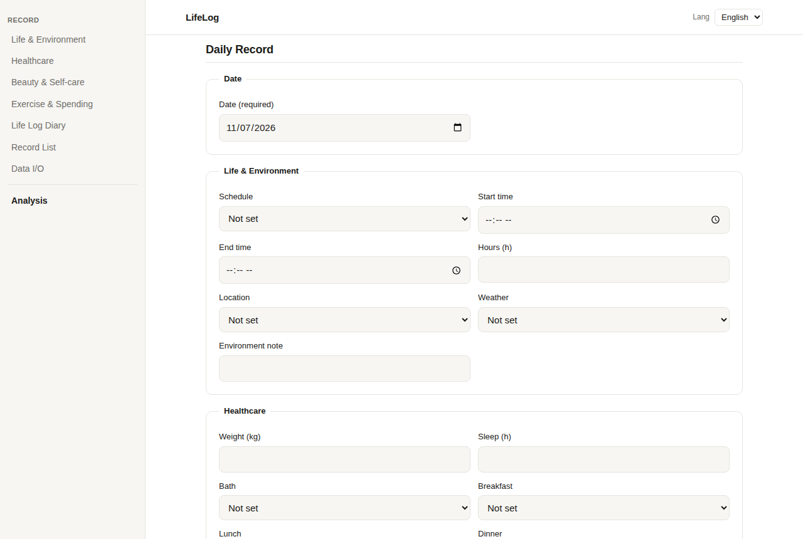
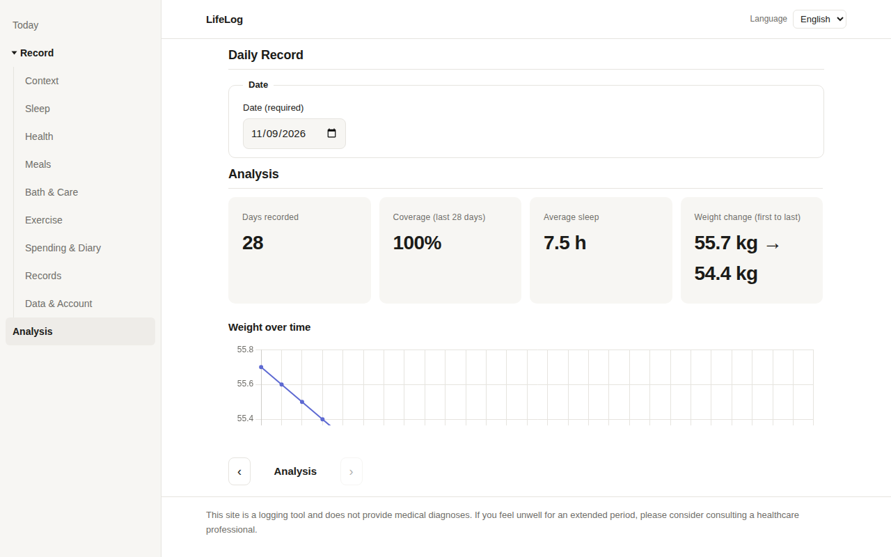

# LifeLog — Personal Life Support & Life Logging

[English](README.md) | [日本語](ja/README.md) | [한국어](ko/README.md)

[](LICENSE)
[](https://mivork.github.io/life-log/)

-success)

A privacy-first life logging web app that tracks your daily habits, health, and spending — all stored locally in your browser. No server, no account, no data collection.

**Live Demo:** https://mivork.github.io/life-log/

## Screenshots





## Features

- **Complete daily tracking** — Sleep, weight, meals, exercise, skincare routine, mental health scores, spending, and free-form journaling
- **Visual analytics** — Weight trends, sleep patterns, condition/mental score charts, and sleep-vs-next-day-condition scatter plots with correlation analysis (presented as hypotheses, not conclusions)
- **Day-type breakdown** — Compare averages across school days, remote days, work days, and days off
- **100% local storage** — All data stays in your browser's localStorage. Nothing is sent to any server
- **JSON import/export** — Back up and restore your data in a portable `data.json` (schema v1) format
- **PWA ready** — Add to your home screen for an app-like experience
- **Multi-language UI** — English, Japanese, and Korean

## Architecture

| Layer | Tech | Location | Role |
|---|---|---|---|
| Frontend | TypeScript / HTML / CSS / Chart.js | `index.html`, `src/`, `css/`, `js/` | Two-tab UI (Record / Analysis). Hosted on GitHub Pages, no auth required |
| Analysis Engine | Python (pandas) | `tools/analysis/` | Generates weekly summaries from data.json (correlation as hypothesis, with n-count and caveats) |
| Sync Tool | Go | `tools/sync-go/` | Schema validation and sync to a private repo (dry-run by default) |
| Validation & Encryption | Rust / WASM | `tools/wasm-crypto/` | Record validation and local encryption with Argon2id + AES-256-GCM (Phase 4) |
| Automation | Shell / Lua | `scripts/`, `rules/` | Batch execution: validate, analyze, commit. Conditional branching via external rule files |
| Native Extension | Kotlin (future) | `docs/future-kotlin.md` | Mobile expansion notes only |

## Usage

### Record Tab

Select a date and enter your daily log. The form covers:

- **Life & Environment** — Schedule type, location (out/home/mixed), weather, notes
- **Healthcare** — Weight, sleep hours, bathing, meals (breakfast/lunch/dinner), condition score (1–5), mental score (1–5), stress level (1–5)
- **Beauty & Self-care** — Face wash, skincare, teeth brushing (morning/night), water intake, caffeine, snacks
- **Exercise & Spending** — Exercise details, ab workout video selection (A–G), long walks, rough spending with tags

Same-date entries are overwritten. You can edit or delete any record from the list below the form.

### Analysis Tab

- **Summary cards** — Total days recorded, recording rate, average sleep, weight change (first to last)
- **Charts** — Weight trend (line), sleep duration (bar), condition & mental scores (line), sleep vs. next-day condition (scatter with Pearson r)
- **Day-type summary table** — Average sleep, condition, and mental scores grouped by schedule type

### Data Import/Export

Export or import in `data.json` schema v1 format. Same-date records are overwritten on import.

## Data Safety Rules (Critical)

1. **Never put real data in this public repository.** Only code and dummy samples belong here.
2. Real `data.json` files go in a private repository or a non-public local folder (also excluded via `.gitignore`).
3. No tokens or credentials are embedded in the code. The sync tool's push authentication relies on the user's own git configuration.
4. All sample data (the "Load dummy sample" button on the frontend, `tools/analysis/sample-data.json`) contains clearly dummy values and is not real data.

## Development

```bash
# Frontend (compile TypeScript)
npx -p typescript tsc -p tsconfig.json   # src/main.ts -> js/main.js

# Local preview
python3 -m http.server 8000              # http://localhost:8000/

# Python analysis (verify with sample data)
python3 tools/analysis/analyze.py tools/analysis/sample-data.json --out /tmp/lifelog-summary

# Go sync (validation + dry-run by default)
cd tools/sync-go && go run . --data /path/to/data.json --repo /path/to/private-repo

# Automation (batch: validate -> analyze -> commit; dry-run by default)
LIFELOG_DATA=/path/to/data.json LIFELOG_REPO=/path/to/private-repo scripts/auto-commit.sh
```

## Coding Conventions

- No inline CSS or inline JS — external files only
- CSS uses `css/tokens.css` + `css/base.css`, unified via `@import` in `css/style.css`
- BEM naming, semantic HTML, WCAG 2.2 AA considerations (visible focus, contrast, label association)

## Phase Status

- Phase 0: Schema v1 finalized, safety design (data path = JSON I/O + browser-only storage)
- Phase 1: Frontend MVP complete (this repository)
- Phase 2: Python analysis engine complete (verified with sample data)
- Phase 3: Go sync tool included (dry-run by default, target configurable)
- Phase 4: Rust/WASM core prepared. Frontend integration design in `docs/phase4-wasm.md`
- Phase 5: Shell/Lua automation included. Kotlin is future-outlook notes only

## License

MIT
