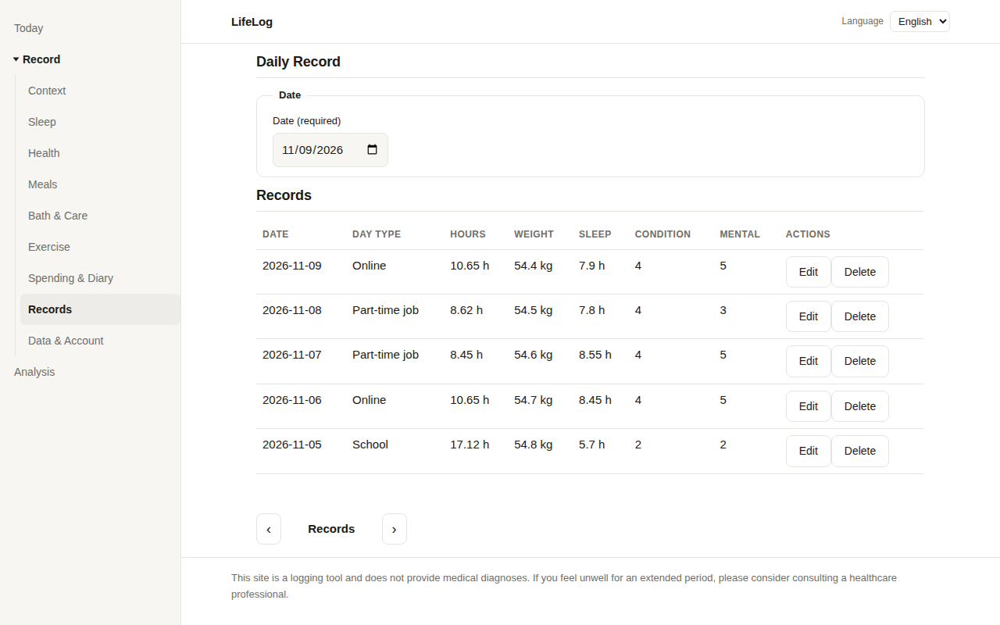
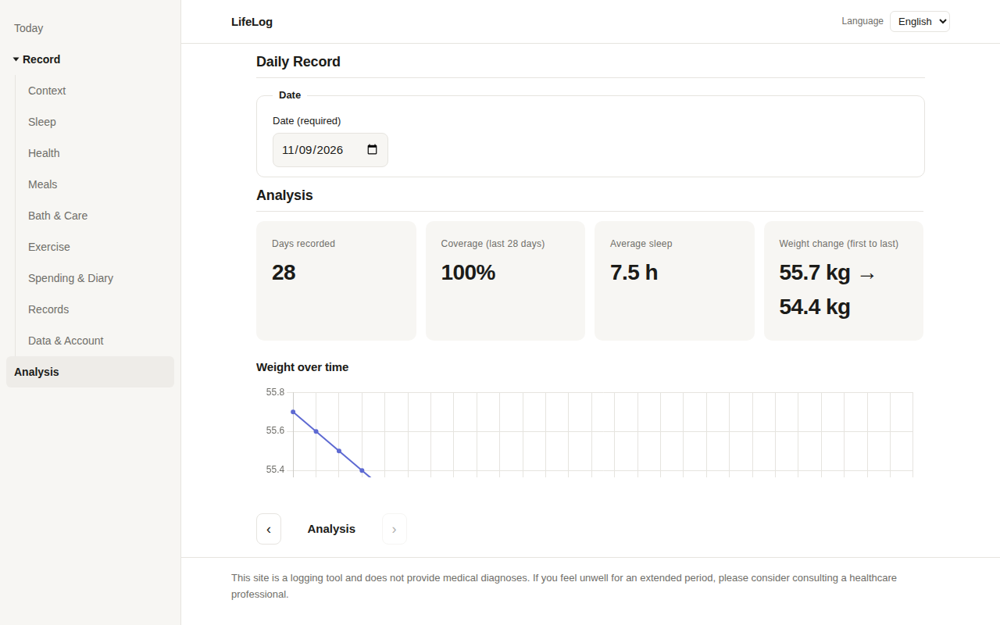
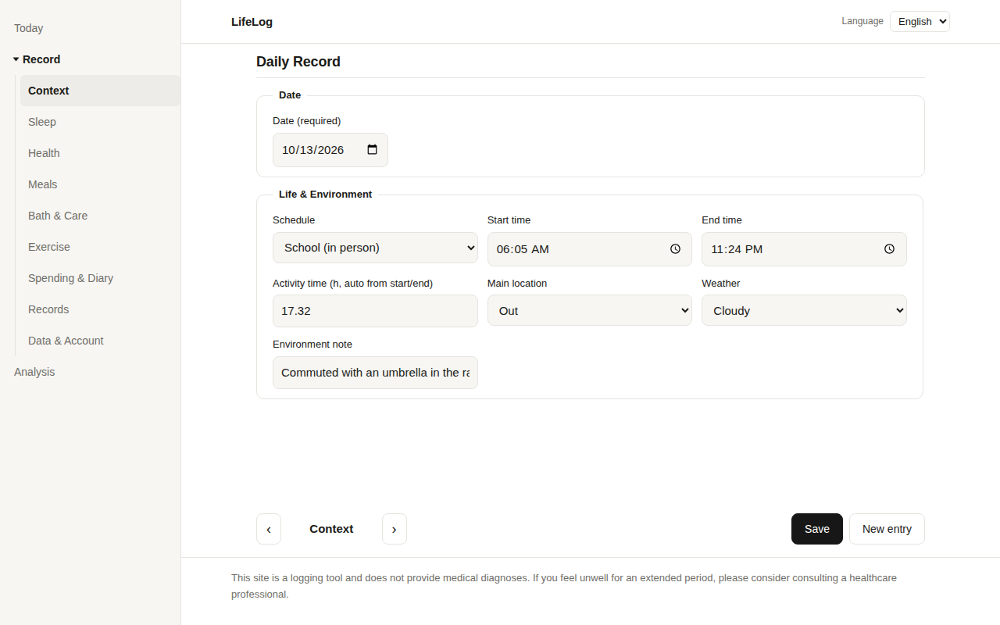

# ライフログ — 生活サポート＆ライフログ Webサイト

[English](../README.md) | [日本語](README.md) | [한국어](../ko/README.md)

自分専用の生活サポート＆ライフログ。多言語・多層アーキテクチャで構築し、
記録はブラウザ内（localStorage）にのみ保存するローカルファースト設計です。

公開URL: https://mivork.github.io/life-log/

## スクリーンショット







## 構成

| 層 | 技術 | 場所 | 役割 |
|---|---|---|---|
| フロントエンド | TypeScript / HTML / CSS / Chart.js | `index.html`, `src/`, `css/`, `js/` | 「記録」「分析」2タブUI。GitHub Pages で公開、認証なし |
| 分析エンジン | Python (pandas) | `tools/analysis/` | data.json から週次サマリー（相関は仮説表現・n数・注意書き付き）を生成 |
| 同期ツール | Go | `tools/sync-go/` | data.json のスキーマ検証とプライベートrepoへの同期（既定 dry-run） |
| 検証・暗号化 | Rust / WASM | `tools/wasm-crypto/` | レコード検証と Argon2id + AES-256-GCM によるローカル暗号化（Phase 4） |
| 自動化 | Shell / Lua | `scripts/`, `rules/` | 検証→分析→コミットの一括実行と、条件分岐ルールの外部記述 |
| ネイティブ拡張 | Kotlin（将来） | `docs/future-kotlin.md` | モバイル展開の拡張メモのみ |

## フロントエンドの使い方

- 「記録」タブ: 日付を選んでその日の記録を入力・保存。同じ日付は上書き編集、一覧から編集/削除ができます。
  記録範囲はスキーマ全項目（生活・環境 / ヘルスケア / 美容・セルフケア / 運動・支出 / 日記）です。
- 「分析」タブ: 体重推移、睡眠時間、体調・メンタルスコア推移、睡眠×翌日体調の散布図と相関、記録率、日種別サマリーを Chart.js で表示します。
- データの入出力: data.json スキーマ v1 形式でエクスポート/インポートできます（同日付は上書き）。
- 保存先はブラウザの localStorage（キー `lifelog.records.v1`）のみ。サーバーへは送信されません。
- PWA 対応（manifest + Service Worker）でホーム画面に追加できます。

## データの置き場所と安全ルール（最重要）

1. **この公開リポジトリには実データを絶対に入れません。** コードとダミーサンプルだけを置きます。
2. 実データ `data.json` はプライベートリポジトリ（または端末内の非公開フォルダ）にのみ置きます（`.gitignore` でも除外済み）。
3. トークン類はコードに埋め込みません。同期ツールの push 認証は利用者の git 設定に委ねます。
4. サンプルデータ（フロント内の「ダミーサンプル」ボタン、`tools/analysis/sample-data.json`）はすべて明確なダミー値で、実データではありません。

## 開発手順

```bash
# フロントエンド (TypeScript をコンパイル)
npx -p typescript tsc -p tsconfig.json   # src/main.ts -> js/main.js

# ローカル確認
python3 -m http.server 8000              # http://localhost:8000/

# Python 分析（サンプルで動作確認）
python3 tools/analysis/analyze.py tools/analysis/sample-data.json --out /tmp/lifelog-summary

# Go 同期（検証 + dry-run が既定）
cd tools/sync-go && go run . --data /path/to/data.json --repo /path/to/private-repo

# 自動化（一括: 検証 → 分析 → コミット。既定 dry-run）
LIFELOG_DATA=/path/to/data.json LIFELOG_REPO=/path/to/private-repo scripts/auto-commit.sh
```

## コーディング規約

- インラインCSS / インラインJS 禁止（外部ファイルのみ）
- CSS は `css/tokens.css` + `css/base.css` を `css/style.css` が `@import` で統合
- BEM 命名、セマンティックHTML、WCAG 2.2 AA 配慮（フォーカス可視・コントラスト・ラベル紐付け）

## フェーズ状況

- Phase 0: スキーマ v1 確定、安全設計（データ到達経路 = JSON入出力 + ブラウザ内保存で開始）
- Phase 1: フロントMVP 完了（本リポジトリ）
- Phase 2: Python 分析エンジン 完了（サンプルで生成確認済み）
- Phase 3: Go 同期ツール 同梱（既定 dry-run、向き先は設定で差し替え可能）
- Phase 4: Rust/WASM 本体を用意。フロント連携は `docs/phase4-wasm.md` の設計メモ参照
- Phase 5: Shell/Lua 自動化 同梱。Kotlin は将来展望メモのみ

## ライセンス

MIT
