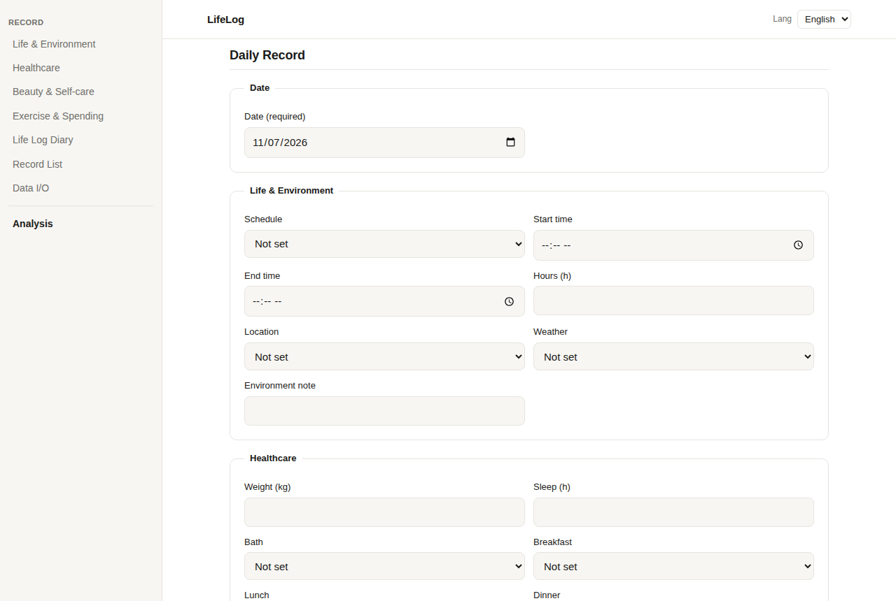
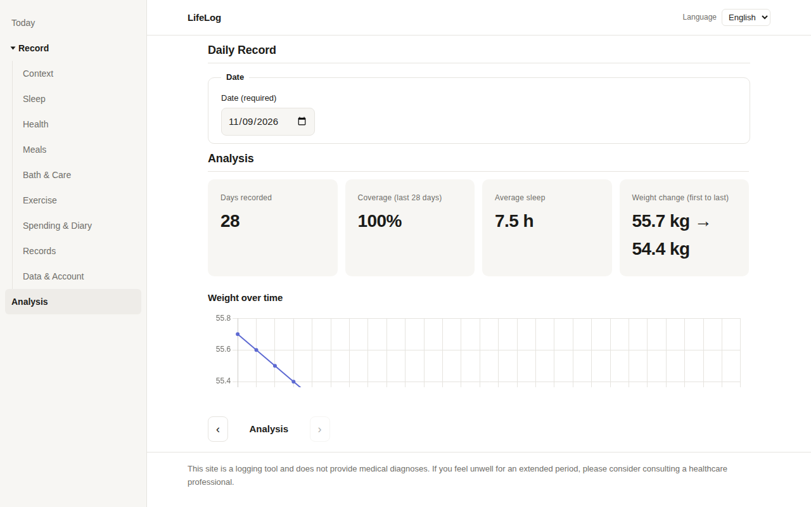

# LifeLog — 개인 생활 지원 & 라이프 로깅

[English](../README.md) | [日本語](../ja/README.md) | [한국어](README.md)

프라이버시 우선 라이프 로깅 웹 앱입니다. 일상의 습관, 건강, 지출을 기록하며 모든 데이터는 브라우저의 localStorage에만 저장됩니다. 서버 없음, 계정 없음, 데이터 수집 없음.

**라이브 데모:** https://mivork.github.io/life-log/

## 스크린샷





## 주요 기능

- **종합 일일 기록** — 수면, 체중, 식사, 운동, 스킨케어 루틴, 정신 건강 점수, 지출, 자유 형식 일기
- **시각적 분석** — 체중 추이, 수면 패턴, 컨디션/멘탈 점수 차트, 수면 대 다음 날 컨디션 산점도와 상관분석(가설로 제시, 인과관계 단정 아님)
- **일정 유형별 분석** — 등교일, 온라인 수업일, 근무일, 휴일별 평균 비교
- **100% 로컬 저장** — 모든 데이터는 브라우저의 localStorage에 보관됩니다. 어떤 서버로도 전송되지 않습니다
- **JSON 가져오기/내보내기** — 이식 가능한 `data.json`(스키마 v1) 형식으로 데이터를 백업 및 복원
- **PWA 지원** — 홈 화면에 추가하여 앱처럼 사용 가능
- **다국어 UI** — 영어, 일본어, 한국어

## 아키텍처

| 레이어 | 기술 | 위치 | 역할 |
|---|---|---|---|
| 프론트엔드 | TypeScript / HTML / CSS / Chart.js | `index.html`, `src/`, `css/`, `js/` | 2탭 UI(기록/분석). GitHub Pages에서 호스팅, 인증 불필요 |
| 분석 엔진 | Python (pandas) | `tools/analysis/` | data.json에서 주간 요약 생성(상관관계는 가설 표현, n수 및 주의사항 포함) |
| 동기화 도구 | Go | `tools/sync-go/` | 스키마 검증 및 비공개 저장소로 동기화(기본 dry-run) |
| 검증 및 암호화 | Rust / WASM | `tools/wasm-crypto/` | 레코드 검증 및 Argon2id + AES-256-GCM 로컬 암호화(Phase 4) |
| 자동화 | Shell / Lua | `scripts/`, `rules/` | 검증 → 분석 → 커밋 일괄 실행 및 조건 분기 규칙의 외부 기술 |
| 네イ티브 확장 | Kotlin(향후) | `docs/future-kotlin.md` | 모바일 확장 메모만 존재 |

## 사용 방법

### 기록 탭

날짜를 선택하고 하루의 기록을 입력합니다. 입력 항목:

- **생활 및 환경** — 일정 유형, 위치(외출/자택/혼합), 날씨, 메모
- **건강 관리** — 체중, 수면 시간, 입욕, 식사(아침/점심/저녁), 컨디션 점수(1–5), 멘탈 점수(1–5), 스트레스 수준(1–5)
- **뷰티 및 셀프케어** — 세안, 스킨케어, 양치(아침/저녁), 수분 섭취, 카페인, 간식
- **운동 및 지출** — 운동 상세, 복근 운동 영상 선택(A–G), 장거리 보행, 대략적 지출 및 태그

같은 날짜의 기록은 덮어쓰기됩니다. 아래 목록에서 편집 또는 삭제할 수 있습니다.

### 분석 탭

- **요약 카드** — 총 기록 일수, 기록률, 평균 수면, 체중 변화(처음 → 마지막)
- **차트** — 체중 추이(꺾은선), 수면 시간(막대), 컨디션 및 멘탈 점수(꺾은선), 수면 대 다음 날 컨디션(산점도, 피어슨 r 포함)
- **일정 유형별 요약 표** — 일정 유형별 평균 수면, 컨디션, 멘탈 점수

### 데이터 가져오기/내보내기

`data.json` 스키마 v1 형식으로 내보내기/가져오기가 가능합니다. 같은 날짜의 레코드는 가져오기 시 덮어쓰기됩니다.

## 데이터 안전 규칙 (필수)

1. **이 공개 저장소에는 실제 데이터를 절대 넣지 마십시오.** 코드와 더미 샘플만 포함합니다.
2. 실제 `data.json` 파일은 비공개 저장소(또는 단말 내 비공개 폴더)에만 보관합니다(`.gitignore`에서도 제외 처리됨).
3. 토큰이나 인증 정보는 코드에 포함하지 않습니다. 동기화 도구의 push 인증은 사용자의 git 설정에 위임합니다.
4. 샘플 데이터(프론트엔드의 "더미 샘플 로드" 버튼, `tools/analysis/sample-data.json`)는 모두 명확한 더미 값이며 실제 데이터가 아닙니다.

## 개발

```bash
# 프론트엔드 (TypeScript 컴파일)
npx -p typescript tsc -p tsconfig.json   # src/main.ts -> js/main.js

# 로컬 미리보기
python3 -m http.server 8000              # http://localhost:8000/

# Python 분석 (샘플 데이터로 동작 확인)
python3 tools/analysis/analyze.py tools/analysis/sample-data.json --out /tmp/lifelog-summary

# Go 동기화 (검증 + dry-run 기본)
cd tools/sync-go && go run . --data /path/to/data.json --repo /path/to/private-repo

# 자동화 (일괄: 검증 → 분석 → 커밋. 기본 dry-run)
LIFELOG_DATA=/path/to/data.json LIFELOG_REPO=/path/to/private-repo scripts/auto-commit.sh
```

## 코딩 규칙

- 인라인 CSS / 인라인 JS 금지 (외부 파일만 사용)
- CSS는 `css/tokens.css` + `css/base.css`를 `css/style.css`에서 `@import`로 통합
- BEM 네이밍, 시맨틱 HTML, WCAG 2.2 AA 고려(포커스 가시성, 대비, 레이블 연결)

## 페이즈 현황

- Phase 0: 스키마 v1 확정, 안전 설계(데이터 경로 = JSON 입출력 + 브라우저 내 저장)
- Phase 1: 프론트엔드 MVP 완료(이 저장소)
- Phase 2: Python 분석 엔진 완료(샘플 데이터로 생성 확인 완료)
- Phase 3: Go 동기화 도구 포함(기본 dry-run, 대상 설정 변경 가능)
- Phase 4: Rust/WASM 본체 준비 완료. 프론트엔드 연동 설계는 `docs/phase4-wasm.md` 참조
- Phase 5: Shell/Lua 자동화 포함. Kotlin은 향후 전망 메모만 존재

## 라이선스

MIT
